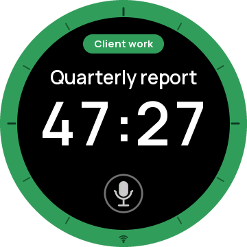
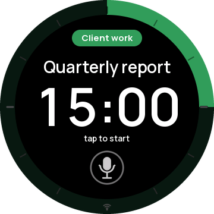
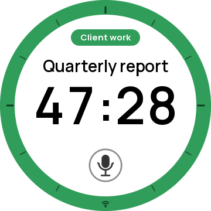

# Knob Timer

A Toggl time tracker for the [Waveshare ESP32-S3-Knob-Touch-LCD-1.8](https://www.waveshare.com/wiki/ESP32-S3-Knob-Touch-LCD-1.8), a round 1.8″ touchscreen with a rotary knob. Tap to start tracking. The knob counts up and logs the time to **Toggl** under your task and project. A second mode is a Pomodoro countdown that logs to Toggl too. You can say what you're working on.

| Tracking | Pomodoro | Inverted |
|:-:|:-:|:-:|
|  |  |  |

*(Screens captured from the device with the test harness.)*

**Docs:**
- [User guide](docs/USER-GUIDE.md): using the knob day to day, with every screen, gesture and status message.
- [Tests](docs/TESTS.md): every scenario the test harness runs, step by step, and what counts as a pass.

## Features

- **Two modes.** Swipe up to switch while the timer is stopped.
  - **Tracking** (the default) counts up. Pause and resume as often as you like: the total keeps adding up, and each running stretch is its own Toggl entry. From an hour on, the time shows as HH:MM:SS.
  - **Pomodoro** counts down from 1–60 minutes. The rim is the clock: an arc from 12 o'clock that shrinks as time runs out.
- **Your task and project, big.** The project sits in a pill at the top, in its Toggl color. The task is under it in large type, and a long one scrolls. With no task it says "Untitled". The rim takes the project's color too.
- **Toggl, as you go.**
  - An entry starts in Toggl the moment you tap start, and stops when you pause, reset or switch tasks.
  - Stopped within 10 seconds? The entry is deleted, so an accidental tap leaves nothing behind.
  - Forgot to start? Turn the knob clockwise while tracking: each click moves the start a minute earlier, in Toggl too. Anticlockwise takes a minute off.
  - Tap the task for your recent entries and pick one. While tracking, that switches to a new entry and the counter keeps going.
  - Tap the pill to pick a project. The running entry follows.
  - Both lists are a copy on the knob: they open at once, work offline and survive a restart. "Sync from Toggl" at the top of each list reloads it.
  - Swipe down to sync. If a timer was started elsewhere (on your phone, say), the knob picks it up. If its own timer was stopped elsewhere, it pauses.
  - The knob only talks to Toggl when you do something. It never polls, because Toggl's free plan allows few requests.
- **Voice tasks.** Tap the mic and say what you're working on. OpenAI speech-to-text turns it into the task, and a waveform shows the knob hearing you. Saying a project name ("Acme review") selects that project. While running, it renames the running entry.
- **Pomodoro warm-up.** In the last 10 minutes the time fades to Leuchtorange (5:00), then to deep red (1:00). In the last minute it pulses like a heartbeat.
- **Time's up you can feel.** The knob vibrates at full strength for 30 seconds. Touch the screen or turn the knob to stop it sooner.
- **Two color profiles:** Mono (white on black) and Inverted (black on white). Swipe left or right to switch, even while running.
- **Offline-friendly.** If Wi-Fi drops mid-run, the start and stop times are kept and sent once it's back (up to 12 stretches, held in memory).
- **You decide when to sync.** The knob never checks Toggl on its own. After a restart it comes back reset, even if its Toggl entry is still running, so pause before you unplug, or swipe down before you start.
- **Remembers** the mode, profile, Pomodoro length, task and project across power-offs.
- **Status at a glance:** a Wi-Fi glyph in the rim at 6 o'clock, steady when connected and pulsing while reconnecting.

## Using the knob

| Do this | Mode | What happens |
|---|---|---|
| Tap the screen | Both | Start, pause, resume. Pomodoro: dismisses "time's up" |
| Hold 0.7 s | Both | Reset. Tracking: to 00:00; Pomodoro: to the length you set. Also clears the task ("Untitled") and the project ("No project") |
| Turn the knob | Tracking, running | Clockwise adds a minute, anticlockwise takes one off (the Toggl entry follows) |
| Turn the knob | Pomodoro | Reset: sets the length (1–60). Paused: to the next whole minute up or down. Running: locked ("pause to adjust") |
| Tap the **task** | Both | Recent tasks: "Sync from Toggl", "Untitled" (where it opens), then the last 20 entries. Turn, then tap to choose |
| Tap the **project pill** | Both | Projects: "Sync from Toggl", "No project" (where it opens), then your projects. Turn, then tap to choose |
| Tap the **mic** | Both | Listen; stops when you pause, or tap again |
| Swipe up | Both | Switch Tracking ↔ Pomodoro (not while running: "pause to switch"). Closes an open list |
| Swipe down | Tracking | Sync with Toggl's running timer. Closes an open list |
| Swipe left / right | Both | Switch Mono ↔ Inverted |

A tap that just misses the mic does nothing (you feel a bump), so a near miss never starts the timer. In a list, a tap chooses the highlighted row only after a turn of the knob, so a reflex tap never changes your task or project. On "Sync from Toggl", a tap reloads that list from Toggl. Lists close by themselves after 10 seconds, and when a Pomodoro runs out.

There's also an interactive design preview of the interface in `preview/toggl-pomodoro-timer.html`. Open it in a browser. It simulates Toggl, including timers started and stopped elsewhere.

## What you need

- The Waveshare ESP32-S3-Knob-Touch-LCD-1.8 and a USB-C cable.
- A Mac or Linux machine with [ESP-IDF v5.5](https://docs.espressif.com/projects/esp-idf/en/v5.5/esp32s3/get-started/). The steps below assume macOS.
- Optional, for voice and Toggl:
  - a 2.4 GHz Wi-Fi network
  - an OpenAI API key
  - a Toggl 2.0 account

## Setup

### 1. Install the toolchain (once)

```sh
mkdir -p ~/esp && cd ~/esp
git clone -b v5.5.6 --recursive https://github.com/espressif/esp-idf.git
cd esp-idf && ./install.sh esp32s3
```

`idf-env.sh` in this repo loads ESP-IDF into your shell:

```sh
. ./idf-env.sh        # from the repo root; prints "ESP-IDF ready: v5.5.6"
```

It pins the Python 3.13 environment that `install.sh` created (`~/.espressif/python_env/idf5.5_py3.13_env`), so a newer or older `python3` on your PATH doesn't break the tools. If your environment has a different name, edit that line.

### 2. Fill in your credentials ("hydrate" the secrets)

```sh
cd firmware
cp main/secrets.example.h main/secrets.h
open -e main/secrets.h      # or any editor
```

`main/secrets.h` is git-ignored. Paste each value between the quotes; leave any you don't want empty.

| Setting | Where to get it |
|---|---|
| `WIFI_SSID`, `WIFI_PASSWORD` | Your 2.4 GHz network's name and password. |
| `OPENAI_API_KEY` | [platform.openai.com](https://platform.openai.com) → Settings → Billing: add a little prepaid credit and **leave auto-recharge off**. Then API keys → Create new secret key (name it "knob"). The key starts with `sk-` and is shown only once. A 5-second task name costs about $0.0004 with `gpt-transcribe`. |
| `TOGGL_API_TOKEN` | Toggl → your profile picture → Profile settings → API Token. Toggl 2.0 keys start with `toggl_sk_`. |
| `TOGGL_ORGANIZATION_ID` | Open Toggl in a browser. The address looks like `focus.toggl.com/1234567/workspaces/7654321/...`, and the **first number** is your organization id. An API key can't look it up, so the knob needs it here. |

The knob cleans up invisible characters that sometimes come along when you copy a key from a web page.

### 3. Build and flash

Plug the knob into your computer. Its single USB-C socket connects to one of two chips depending on which way the plug goes. You want the ESP32-S3, which shows up as `/dev/cu.usbmodem101` on macOS. If you see `/dev/cu.usbserial-…` instead, **flip the plug at the knob end**.

```sh
cd firmware
idf.py build
idf.py -p /dev/cu.usbmodem101 flash
```

The first build downloads one component (`esp_lcd_sh8601`) and takes a few minutes. After flashing, the knob restarts and shows the timer. With credentials filled in, it joins Wi-Fi in about 2 seconds and is ready for Toggl about 5 seconds after boot.

To watch the log: `idf.py -p /dev/cu.usbmodem101 monitor` (Ctrl-] to quit).

### 4. Check that everything works

```sh
python tools/knob_test.py --quick     # a few minutes, no side effects
```

See [Testing](#testing) for the full suite.

## Testing

`firmware/tools/knob_test.py` tests the real knob end to end over USB:

- boot and memory
- Wi-Fi and Toggl
- the layout, the long-task scroll, both profiles and the Pomodoro rim (from screen captures)
- both modes: counting up, pausing, the knob, time's up and its buzzing
- hit areas and the mic's dead zone
- the task and project lists
- voice
- Toggl sync: immediate starts, deleting accidental starts, moving the start, switching tasks, syncing with timers started elsewhere, offline
- telemetry, frame rate and crashes

Every scenario, what it does and what counts as a pass, is in **[docs/TESTS.md](docs/TESTS.md)**.

```sh
cd firmware && . ../idf-env.sh
python tools/knob_test.py              # everything, about 10 minutes
python tools/knob_test.py --quick      # skip slow cases and side effects
python tools/knob_test.py --only R4,S5 # chosen cases
python tools/knob_test.py --telemetry  # also save TELEMETRY lines
```

The full run speaks a phrase through the Mac's speakers and creates a few short Toggl entries named `knob-test …`. Delete those afterwards if you like. Timer cases that aren't about Toggl run with Wi-Fi switched off, so they don't use up Toggl's request limit. Your mode, profile, length, task and project are restored at the end.

Results go to `firmware/test-output/`: `report.json`, the serial log, and PNG captures of the real screen.

## Telemetry and debugging

The firmware has a debug interface on the USB serial port that the test harness uses. You can use it too, from any serial terminal:

- **Single keys:** `d` prints the state as JSON, `c` captures the screen, `s` starts or pauses, and so on.
- **`#` commands:** `#task …`, `#project ID`, `#set N`, `#app track|pomo`, `#theme mono|inverted`, `#wifi off`, `#list`, `#reboot`, and `#toggl start|stop` to start or stop a Toggl timer as another device would.

**Telemetry is off by default.** `#telemetry on` makes the knob print a `TELEMETRY {...}` line every 5 seconds with:

- uptime and timer state
- free and minimum internal RAM, and PSRAM
- Wi-Fi signal (RSSI)
- whether the clock is synced
- Toggl readiness, pending entries and retry backoff
- the last HTTP status and its duration
- the network error count

The setting survives restarts until you send `#telemetry off`. It never includes keys or passwords. When telemetry is off, its cost is one check per frame; when on, one short line every 5 s.

For a build that doesn't listen on USB at all, run `idf.py menuconfig` → **Knob Pomodoro** → turn off **Debug interface**. The timer, voice and Toggl work the same.

## Troubleshooting

| Symptom | Fix |
|---|---|
| No `/dev/cu.usbmodem*` port | Flip the USB-C plug at the knob end; the other orientation reaches the second chip. |
| No mic on the screen, or "Toggl isn't set up" | That key is empty in `main/secrets.h`; fill it in, rebuild and flash. |
| A new project or past entry isn't in a list | The lists are a cached copy. Turn up to "Sync from Toggl" in that list and tap. |
| "not saved in Toggl" | Toggl turned down a start or a change for good (for example, the project was archived). The knob keeps counting; swipe down to see what Toggl has. |
| "no Wi-Fi", or the Wi-Fi glyph keeps pulsing | Check the network name and password, and that the network is 2.4 GHz. |
| Log says `Toggl rejected the API key` | Use a Toggl 2.0 key (`toggl_sk_…`), not a classic Toggl Track token. |
| Log says it can't find your Toggl organization | Set `TOGGL_ORGANIZATION_ID` (the first number in Toggl's web address). |
| "didn't catch that" | Speak within about an arm's length and pause when done. Background talking keeps it listening (up to 15 s). |
| Transcription is slow | Usually a weak Wi-Fi signal. Check `rssi` with `#telemetry on`. |

To restore the board's original Waveshare demo firmware, you need a full flash backup made before the first flash (this repo kept one locally in `backup/`; it isn't committed):

```sh
esptool.py --port /dev/cu.usbmodem101 write_flash 0 backup/factory-firmware-esp32s3-16MB.bin
```

## How it works

- **Display.** A 360×360 ST77916 panel over QSPI, drawn by a small software renderer (no GUI library):
  - Two static backgrounds hold the face, the project pill, the ticks and the rim: one with the rim band off, one with it on. Each frame picks between them per pixel, which draws the Pomodoro arc.
  - A text layer (task, time, status, mic) is composited per row, and only rows that changed are redrawn, in 24-row bands sent by DMA.
  - The whole interface is rotated 180° relative to the panel.
- **Input.**
  - **Knob:** not quadrature; each direction pulses its own GPIO.
  - **Touch:** a CST816 controller.
  - **Haptics:** a DRV2605 vibration driver.
- **Voice.**
  - The onboard PDM microphone records at 16 kHz.
  - A 150 Hz high-pass filter removes hum, and live speech detection ends the recording after about 1.3 s of quiet.
  - The audio goes to OpenAI's `gpt-transcribe` as a WAV upload.
- **Toggl.** Toggl 2.0's API (`focus.toggl.com/api`, Bearer key):
  - Runs are started and stopped through `tracking/start` and `tracking/stop`. Before stopping, the knob checks `tracking/current` to make sure the running timer is still the one it started.
  - Knob adjustments, renames and project changes go out as one `PATCH` once they settle (1.5 s), carrying only the fields that changed. Accidental starts are removed with `DELETE`.
  - Swipe-down sync is a single `tracking/current` request.
  - Recent entries come from a `time-entries` query (the newest 50 from the last 30 days, kept as the last 20 distinct tasks), and projects from the workspace's `projects`. Both are cached in NVS and loaded only on the first start or by "Sync from Toggl". Tasks the knob starts go to the top of the cache without a request.
- **Networking.** One background task handles all HTTPS, so the screen never waits. It uses public DNS (1.1.1.1 and 8.8.8.8), IPv4, 32 KB TCP windows and software AES, with retries for dropped connections.

## Project layout

```
README.md                           this file
AGENTS.md                           guidance for coding agents
TODO.md                             open UX problems for future work
idf-env.sh                          loads ESP-IDF into the shell
docs/
  USER-GUIDE.md                     how to use the knob, with screenshots
  TESTS.md                          every test scenario and its pass condition
  assets/screens/                   screenshots captured from the device
  assets/user-guide/                screenshots of the preview for the user guide
preview/toggl-pomodoro-timer.html   interactive design preview (keep in sync with the firmware)
firmware/
  main/                             the application (C)
    main.c                          state machine, input handling, debug interface, telemetry
    render.c / .h                   software renderer (face, rim, pill, text, lists, capture)
    display.c / .h                  QSPI panel driver setup, DMA bands
    input.c / .h                    knob and touch gestures
    mic.c / .h                      microphone capture, speech detection, clean-up
    net.c / .h                      Wi-Fi, DNS, clock sync
    cloud.c / .h                    OpenAI transcription, Toggl 2.0 client, offline queue
    haptics.c, settings.c, color.c, board.h, project.h, config.h
    assets.c / .h                   generated glyphs and icons (tools/gen_assets.py)
    secrets.example.h               credentials template (copy to secrets.h)
    Kconfig.projbuild               build options (debug interface)
  tools/
    knob_test.py                    end-to-end test harness
    gen_assets.py                   regenerates assets.c from the Manrope font (needs Pillow and fontTools)
    fonts/                          Manrope (SIL Open Font License)
  partitions.csv, sdkconfig.defaults, sdkconfig
```

## Privacy

- Audio leaves the knob only when you tap the mic, and only to OpenAI for transcription.
- Transcripts and Toggl task names appear in the serial log, which stays on your computer. The test output folder is git-ignored.
- Your keys live only in `main/secrets.h`, which is git-ignored, and in the firmware you flash to your own device.

## Credits

- [Manrope](https://github.com/sharanda/manrope) font (SIL Open Font License, see `firmware/tools/fonts/OFL.txt`).
- The display init sequence and pin map come from Waveshare's demo code for this board.
