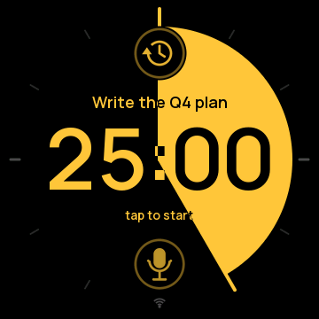
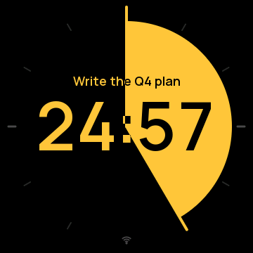
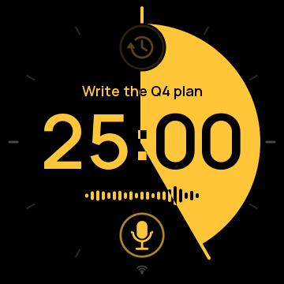

# Knob Pomodoro

A focus timer for the [Waveshare ESP32-S3-Knob-Touch-LCD-1.8](https://www.waveshare.com/wiki/ESP32-S3-Knob-Touch-LCD-1.8), a round 1.8″ touchscreen with a rotary knob. You set the length with the knob and tap to start. Two clock hands sweep a slice that shrinks as time runs out. You can say what you're working on, and the knob logs the time to **Toggl** for you.

| Ready | Running | Listening |
|:-:|:-:|:-:|
|  |  |  |

*(Screens captured from the device with the test harness.)*

## Features

- **One adjustable timer, 1–60 minutes.** The full circle is 60 minutes. The slice between the fixed 12 o'clock hand and the moving hand is the time left.
- **Calm warm-up.** In the last 10 minutes the slice fades from your color profile to Leuchtorange (5:00), then to deep red (1:00). In the last minute the time itself pulses like a heartbeat. Time's up buzzes the vibration motor.
- **Voice tasks.** Tap the mic and say what you're working on. OpenAI speech-to-text turns it into the task name shown above the time, and a waveform shows the knob hearing you. Saying a project name ("Acme review") selects that project.
- **Toggl.**
  - Every stretch of running time becomes a Toggl entry with your task and project. Pauses aren't logged, and runs under 10 seconds are ignored.
  - The clock badge at the top lists your recent entries, newest first, so you can pick one as the task. "No task" clears it.
  - Swipe down to pick a project. The rim around the dial takes the project's Toggl color.
- **Offline-safe.** If Wi-Fi drops mid-run, the start and stop times are kept and sent once it's back.
- **8 color profiles** for the slice: Sunflower, Lagoon, Lime, Glacier, Mint, Seafoam, Cream, Mono. The face is always black.
- **Remembers** the length, profile, task and project across power-offs.
- **Status at a glance:** a Wi-Fi glyph in the rim at 6 o'clock, steady when connected and pulsing while reconnecting.

## Using the knob

| Do this | When | What happens |
|---|---|---|
| Turn the knob | Reset | Sets the length, one minute per click (1–60) |
| Turn the knob | Paused | Steps whole minutes; the seconds go back to :00 |
| Turn the knob | Running | Locked (a soft bump and "pause to adjust") |
| Tap the screen | Any time | Start, pause, resume; dismisses "time's up" |
| Hold 0.7 s | Running or paused | Reset to the set length |
| Tap the **mic** (bottom) | Stopped | Listen; stops when you pause, or tap again |
| Tap the **clock badge** (top) | Stopped | Recent Toggl entries; turn to scroll, tap to choose |
| Swipe down | Stopped | Toggl projects; turn to scroll, tap to choose, swipe up to close |
| Swipe left / right | Stopped | Change the slice's color profile |

A tap that just misses a button does nothing (you feel a bump), so a near miss never starts the timer. Lists close by themselves after 10 seconds.

There's also an interactive design preview of the interface in `preview/knob-pomodoro.html`. Open it in a browser.

## What you need

- The Waveshare ESP32-S3-Knob-Touch-LCD-1.8 and a USB-C cable.
- A Mac or Linux machine with [ESP-IDF v5.5](https://docs.espressif.com/projects/esp-idf/en/v5.5/esp32s3/get-started/). The steps below assume macOS.
- Optional, for voice and Toggl:
  - a 2.4 GHz Wi-Fi network
  - an OpenAI API key
  - a Toggl 2.0 account

## Setup

### 1. Install the toolchain (once)

```sh
mkdir -p ~/esp && cd ~/esp
git clone -b v5.5.6 --recursive https://github.com/espressif/esp-idf.git
cd esp-idf && ./install.sh esp32s3
```

`idf-env.sh` in this repo loads ESP-IDF into your shell:

```sh
. ./idf-env.sh        # from the repo root; prints "ESP-IDF ready: v5.5.6"
```

It pins the Python 3.13 environment that `install.sh` created (`~/.espressif/python_env/idf5.5_py3.13_env`), so a newer or older `python3` on your PATH doesn't break the tools. If your environment has a different name, edit that line.

### 2. Fill in your credentials ("hydrate" the secrets)

```sh
cd firmware
cp main/secrets.example.h main/secrets.h
open -e main/secrets.h      # or any editor
```

`main/secrets.h` is git-ignored. Paste each value between the quotes; leave any you don't want empty.

| Setting | Where to get it |
|---|---|
| `WIFI_SSID`, `WIFI_PASSWORD` | Your 2.4 GHz network's name and password. |
| `OPENAI_API_KEY` | [platform.openai.com](https://platform.openai.com) → Settings → Billing: add a little prepaid credit and **leave auto-recharge off**. Then API keys → Create new secret key (name it "knob"). The key starts with `sk-` and is shown only once. A 5-second task name costs about $0.0004 with `gpt-transcribe`. |
| `TOGGL_API_TOKEN` | Toggl → your profile picture → Profile settings → API Token. Toggl 2.0 keys start with `toggl_sk_`. |
| `TOGGL_ORGANIZATION_ID` | Open Toggl in a browser. The address looks like `focus.toggl.com/1234567/workspaces/7654321/...`, and the **first number** is your organization id. An API key can't look it up, so the knob needs it here. |

The knob cleans up invisible characters that sometimes come along when you copy a key from a web page.

### 3. Build and flash

Plug the knob into your computer. Its single USB-C socket connects to one of two chips depending on which way the plug goes. You want the ESP32-S3, which shows up as `/dev/cu.usbmodem101` on macOS. If you see `/dev/cu.usbserial-…` instead, **flip the plug at the knob end**.

```sh
cd firmware
idf.py build
idf.py -p /dev/cu.usbmodem101 flash
```

The first build downloads one component (`esp_lcd_sh8601`) and takes a few minutes. After flashing, the knob restarts and shows the timer. With credentials filled in, it joins Wi-Fi in about 2 seconds and is ready for Toggl about 5 seconds after boot.

To watch the log: `idf.py -p /dev/cu.usbmodem101 monitor` (Ctrl-] to quit).

### 4. Check that everything works

```sh
python tools/knob_test.py --quick     # about 2 minutes, no side effects
```

See [Testing](#testing) for the full suite.

## Testing

`firmware/tools/knob_test.py` tests the real knob end to end over USB:

- boot and memory
- Wi-Fi and Toggl
- the knob, timer and time's up
- gestures, hit areas, the dead zone and color profiles
- the project and entry lists, and the task display
- voice
- Toggl sync, including offline
- telemetry, frame rate and crashes

The cases are listed in **[firmware/TESTS.md](firmware/TESTS.md)**.

```sh
cd firmware && . ../idf-env.sh
python tools/knob_test.py              # everything, about 5 minutes
python tools/knob_test.py --quick      # skip slow cases and side effects
python tools/knob_test.py --only K4,S2 # chosen cases
python tools/knob_test.py --telemetry  # also save TELEMETRY lines
```

The full run speaks a phrase through the Mac's speakers and creates a few short Toggl entries named `knob-test …`. Delete those afterwards if you like. Your length, profile, task and project are restored at the end.

Results go to `firmware/test-output/`: `report.json`, the serial log, and PNG captures of the real screen.

## Telemetry and debugging

The firmware has a debug interface on the USB serial port that the test harness uses. You can use it too, from any serial terminal:

- **Single keys:** `d` prints the state as JSON, `c` captures the screen, `s` starts or pauses, and so on.
- **`#` commands:** `#task …`, `#project ID`, `#set N`, `#wifi off`, `#list`, `#reboot`.

**Telemetry is off by default.** `#telemetry on` makes the knob print a `TELEMETRY {...}` line every 5 seconds with:

- uptime and timer state
- free and minimum internal RAM, and PSRAM
- Wi-Fi signal (RSSI)
- whether the clock is synced
- Toggl readiness, pending entries and retry backoff
- the last HTTP status and its duration
- the network error count

The setting survives restarts until you send `#telemetry off`. It never includes keys or passwords. When telemetry is off, its cost is one check per frame; when on, one short line every 5 s.

For a build that doesn't listen on USB at all, run `idf.py menuconfig` → **Knob Pomodoro** → turn off **Debug interface**. The timer, voice and Toggl work the same.

## Troubleshooting

| Symptom | Fix |
|---|---|
| No `/dev/cu.usbmodem*` port | Flip the USB-C plug at the knob end; the other orientation reaches the second chip. |
| "voice isn't set up" / "Toggl isn't set up" | That key is empty in `main/secrets.h`; fill it in, rebuild and flash. |
| "no Wi-Fi", or the Wi-Fi glyph keeps pulsing | Check the network name and password, and that the network is 2.4 GHz. |
| Log says `Toggl rejected the API key` | Use a Toggl 2.0 key (`toggl_sk_…`), not a classic Toggl Track token. |
| Log says it can't find your Toggl organization | Set `TOGGL_ORGANIZATION_ID` (the first number in Toggl's web address). |
| "didn't catch that" | Speak within about an arm's length and pause when done. Background talking keeps it listening (up to 15 s). |
| Transcription is slow | Usually a weak Wi-Fi signal. Check `rssi` with `#telemetry on`. |

To restore the board's original Waveshare demo firmware, you need a full flash backup made before the first flash (this repo kept one locally in `backup/`; it isn't committed):

```sh
esptool.py --port /dev/cu.usbmodem101 write_flash 0 backup/factory-firmware-esp32s3-16MB.bin
```

## How it works

- **Display.** A 360×360 ST77916 panel over QSPI, drawn by a small software renderer (no GUI library):
  - A static background holds the ticks and the project rim.
  - Text layers are drawn per row and composited, and only rows that changed are redrawn, in 24-row bands sent by DMA.
  - The whole interface is rotated 180° relative to the panel.
- **Input.**
  - **Knob:** not quadrature; each direction pulses its own GPIO.
  - **Touch:** a CST816 controller.
  - **Haptics:** a DRV2605 vibration driver.
- **Voice.**
  - The onboard PDM microphone records at 16 kHz.
  - A 150 Hz high-pass filter removes hum, and live speech detection ends the recording after about 1.3 s of quiet.
  - The audio goes to OpenAI's `gpt-transcribe` as a WAV upload.
- **Toggl.** Toggl 2.0's API (`focus.toggl.com/api`, Bearer key):
  - Runs are started and stopped through `tracking/start` and `tracking/stop`.
  - Before stopping, the knob checks that the running timer is still the one it started.
  - Entries come from a `time-entries` query (newest 50, finished ones only).
- **Networking.** One background task handles all HTTPS, so the screen never waits. It uses public DNS (1.1.1.1 and 8.8.8.8), IPv4, 32 KB TCP windows and software AES, with retries for dropped connections.

## Project layout

```
README.md, AGENTS.md         this file; guidance for coding agents
idf-env.sh                   loads ESP-IDF into the shell
docs/screens/                screenshots captured from the device
preview/knob-pomodoro.html   interactive design preview (keep in sync with the firmware)
firmware/
  main/                      the application (C)
    main.c                   state machine, input handling, debug interface, telemetry
    render.c / .h            software renderer (dial, text, buttons, lists, capture)
    display.c / .h           QSPI panel driver setup, DMA bands
    input.c / .h             knob and touch gestures
    mic.c / .h               microphone capture, speech detection, clean-up
    net.c / .h               Wi-Fi, DNS, clock sync
    cloud.c / .h             OpenAI transcription, Toggl 2.0 client, offline queue
    haptics.c, settings.c, color.c, board.h, project.h, config.h
    assets.c / .h            generated glyphs and icons (tools/gen_assets.py)
    secrets.example.h        credentials template (copy to secrets.h)
    Kconfig.projbuild        build options (debug interface)
  tools/
    knob_test.py             end-to-end test harness
    gen_assets.py            regenerates assets.c from the Manrope font (needs Pillow)
    fonts/                   Manrope (SIL Open Font License)
  TESTS.md                   test catalog
  partitions.csv, sdkconfig.defaults, sdkconfig
```

## Privacy

- Audio leaves the knob only when you tap the mic, and only to OpenAI for transcription.
- Transcripts and Toggl task names appear in the serial log, which stays on your computer. The test output folder is git-ignored.
- Your keys live only in `main/secrets.h`, which is git-ignored, and in the firmware you flash to your own device.

## Credits

- [Manrope](https://github.com/sharanda/manrope) font (SIL Open Font License, see `firmware/tools/fonts/OFL.txt`).
- The display init sequence and pin map come from Waveshare's demo code for this board.
