# Knob Timer user guide

How to use the knob day to day: what the screen shows, what every gesture does, and how it keeps Toggl up to date. To build, flash and set up Wi-Fi and the API keys, see the [README](../README.md#setup).

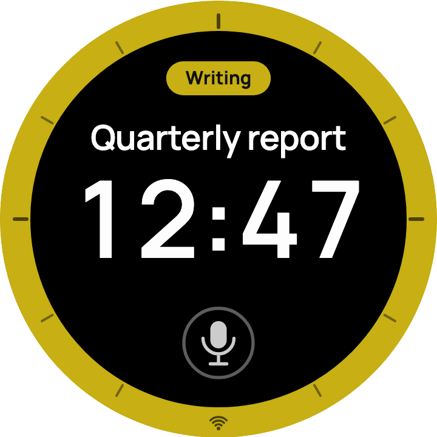

*The screenshots come from the design preview (`preview/toggl-pomodoro-timer.html`) and use made-up tasks and projects. The knob shows your own, in their Toggl colors.*

## Contents

- [The screen](#the-screen)
- [Gestures at a glance](#gestures-at-a-glance)
- [Tracking mode](#tracking-mode)
- [Pomodoro mode](#pomodoro-mode)
- [Your task and project](#your-task-and-project)
- [Voice](#voice)
- [How it works with Toggl](#how-it-works-with-toggl)
- [Color profiles](#color-profiles)
- [Wi-Fi](#wi-fi)
- [Status messages](#status-messages)
- [Troubleshooting](#troubleshooting)

## The screen

From top to bottom:

| Part | What it shows |
|---|---|
| **Project pill** | The Toggl project, filled with its Toggl color. The text turns dark on light colors and white on dark ones, and a long name ends in "…". With no project, it's an outlined "No project" pill. Tap it for the [projects list](#projects). |
| **Task** | What you're working on, in large type. A task too wide for the screen rests for 2 seconds, then scrolls through in a loop, fading at the edges. With no task it says "Untitled" in gray. Tap it for your [past tasks](#past-tasks). |
| **Time** | Tracking counts up, Pomodoro counts down. MM:SS, and from one hour on HH:MM:SS in smaller digits. While paused, the time and task are dimmed. |
| **Status line** | A short word or two under the time: "tap to track", "paused", "time's up", and brief confirmations such as "reset". Every message is listed in [Status messages](#status-messages). While you speak, a waveform replaces it. |
| **Mic** | The only button. Tap it to say your task. It's hidden if voice isn't set up (no OpenAI key) and while a list is open. |
| **Rim** | Tracking: a full ring in the project's color. With no project it's white (black in the Inverted profile). Pomodoro: an arc from 12 o'clock that shows the time left out of 60 minutes, over a faint full ring. |
| **Wi-Fi glyph** | In the rim at 6 o'clock. Steady when connected, pulsing while the knob reconnects. If no Wi-Fi network is set up, a normal tick sits there instead. |

When you press and hold, a thin gray ring fills around the middle of the screen. When it closes (0.7 s), the hold counts as a reset. A reset also sets the task back to "Untitled" and clears the project.

## Gestures at a glance

| Do this | Tracking | Pomodoro | In a list |
|---|---|---|---|
| **Tap the screen** | Start, pause, resume | Start, pause, resume. At time's up: back to the set length | After a turn: choose the highlighted row. On "Sync from Toggl": reload the list. Without a turn: close (see [lists](#your-task-and-project)) |
| **Hold 0.7 s** | Reset to 00:00, clear the task and the project | Reset to the set length, clear the task and the project | Nothing |
| **Turn the knob** | Running: each click moves the start a minute (clockwise = more time). Stopped: a bump | Reset: set the length (1–60 min). Paused: whole minutes. Running: locked | Scroll |
| **Tap the task** | Past tasks list | Past tasks list | (Choose) |
| **Tap the pill** | Projects list | Projects list | (Choose) |
| **Tap the mic** | Say the task | Say the task | (Mic hidden) |
| **Swipe up** | Switch to Pomodoro (not while running) | Switch to Tracking (not while running) | Close without choosing |
| **Swipe down** | Sync with Toggl | Nothing | Close without choosing |
| **Swipe left or right** | Switch color profile | Switch color profile | Nothing |

- **Near misses on the mic.** A tap that just misses the mic (within about 10 px of it, below the status line) gives a bump and does nothing else, so a near miss never starts the timer. A tap on the status line itself is a normal tap.
- **While you're speaking** (the waveform is showing), any tap stops listening. Hold and swipe up and down are ignored.
- **During time's up**, any touch or knob turn first stops the vibration.
- **The knob clicks back.** You feel a light click for each step (a fast spin skips some), a bump at a limit or when something isn't available, a firm tap for start, pause and changes, and a double pulse for a reset.

## Tracking mode

Tracking is the main mode. It counts up from 00:00.

- **Tap** to start. The time counts up and the status line is empty.
- **Tap** again to pause. The total stays and the status line breathes "paused". Tap to resume: the total keeps adding up.
- **Hold** to reset ("reset"). The time goes back to 00:00, the task to "Untitled", and the project to "No project". If the timer runs, its Toggl entry stops first. Holding when all of these are already reset just bumps.
- **Turn the knob while running** to fix the start. Each clockwise click adds a minute, for when you started working before you tapped. Each anticlockwise click takes a minute off, but never more than the current stretch has run. When the timer isn't running, the knob just bumps.
- **From one hour on**, the time shows as HH:MM:SS in smaller digits.

Every running stretch is its own Toggl entry with the same task and project. See [How it works with Toggl](#how-it-works-with-toggl).

| Paused | Past an hour |
|:-:|:-:|
| 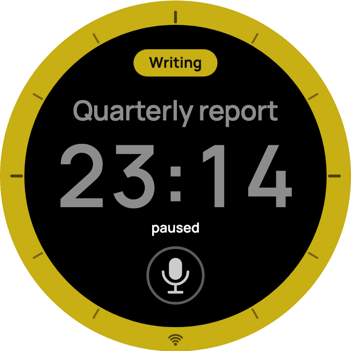 | 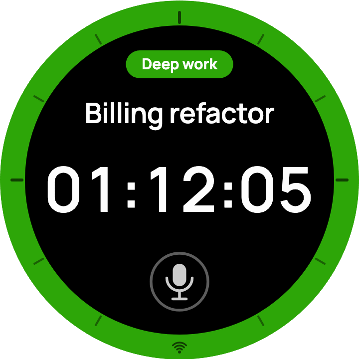 |

## Pomodoro mode

Pomodoro counts down from a length you set, from 1 to 60 minutes. Its runs are logged to Toggl too.

- **Set the length** by turning the knob while the timer is reset. Each click is a minute, and the arc on the rim grows and shrinks with it. At the ends you'll see "1 min minimum" or "60 min maximum". A 60-minute timer shows 60:00.
- **Tap** to start. The arc shrinks as time runs out. The knob is locked while running ("pause to adjust").
- **Tap** to pause. Turning the knob now moves to whole minutes: clockwise up to the next one (24:58 becomes 25:00), anticlockwise down to the one below (24:58 becomes 24:00). The set length doesn't change.
- **Hold** to reset ("reset"). The time goes back to the set length, the task to "Untitled", and the project to "No project". If the countdown runs, its Toggl entry stops first. Holding when all of these are already reset just bumps.

| Set to 25 minutes | Running |
|:-:|:-:|
| 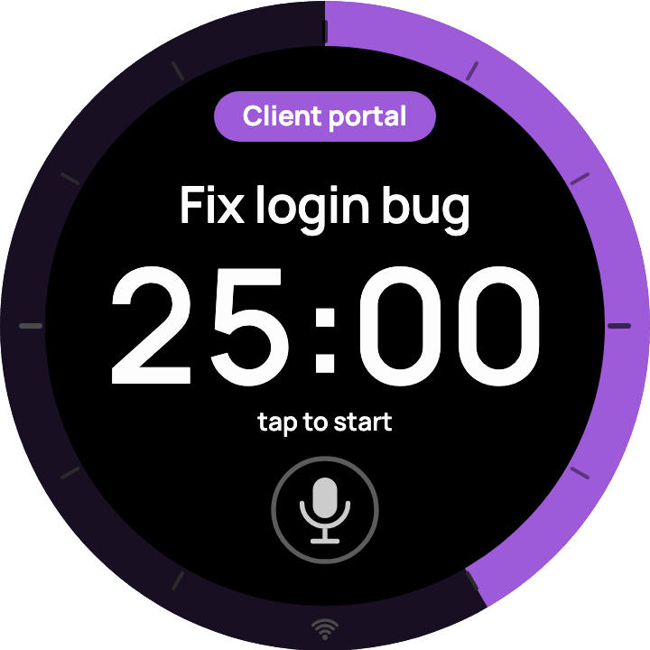 | 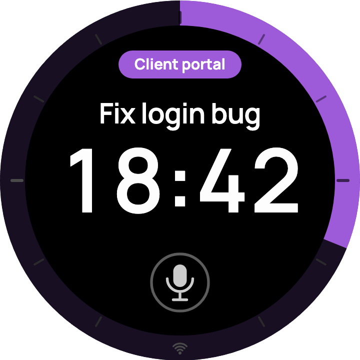 |

The Pomodoro rim always sits on a black band with gray ticks, in both color profiles. The arc takes the project's color, or white with no project.

### Warm-up, last minute and time's up

- **Warm-up.** From 10 minutes left, the time, status and mic fade from white (or black) toward **Leuchtorange** (#FF4D06), reaching it at 5:00. They then fade to **crimson** (#E8143A) by 1:00. The color follows the time left, so it also shows on a short timer before you start, and while paused.
- **The last minute.** The time pulses once a second, swelling slightly with a glow, like a heartbeat.
- **Time's up.** The time reads 00:00, the status says "time's up", the pulse continues, and the knob **vibrates at full strength for 30 seconds**. To stop it sooner:
  - **Turn the knob:** the vibration stops and "time's up" stays on screen.
  - **Tap:** the vibration stops and the timer goes back to the set length in one go.
  - **Hold:** the same as a tap, and the task and the project are also cleared.
  - **Swipe:** the vibration stops and the swipe does its usual job. Swiping up switches to Tracking; "time's up" is still there when you come back.

  If a list is open when time runs out, it closes, so you see "time's up" and your tap can't choose a row by accident.

| Under 5 minutes | Last minute | Time's up |
|:-:|:-:|:-:|
| 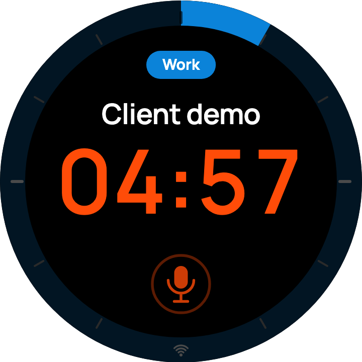 | 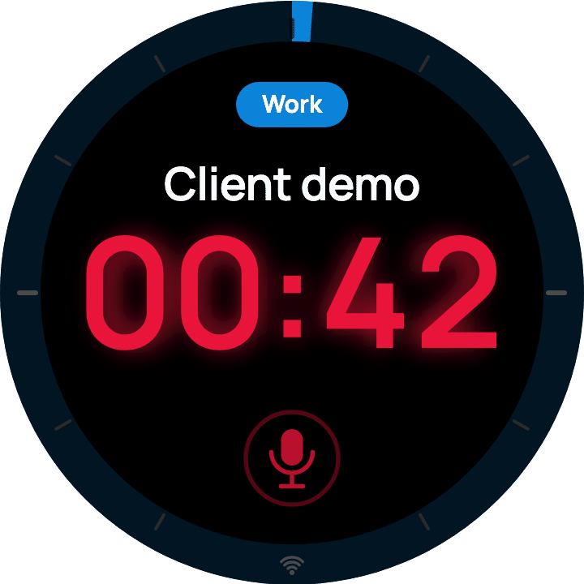 | 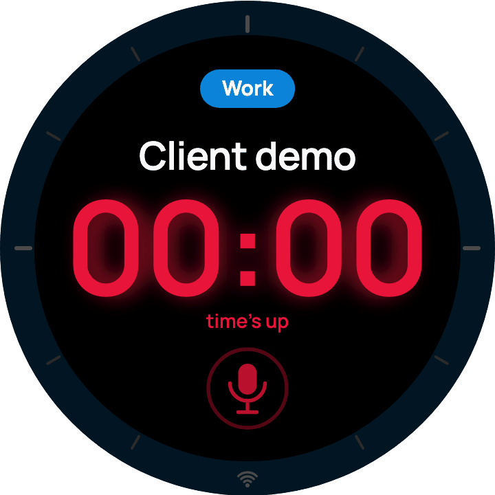 |

### Switching modes

**Swipe up** to switch between Tracking and Pomodoro. You'll see "pomodoro" or "tracking". It only works while the timer isn't running: pause first, or you'll see "pause to switch". Each mode keeps its own state, so a paused Tracking total is still there when you come back. The knob remembers the mode, the Pomodoro length, the profile, the task and the project across power-offs, but not a running timer (see [Restarts](#restarts-and-power-loss)).

## Your task and project

Both lists come from a copy on the knob, so they open at once, also offline, and opening them sends nothing to Toggl. The copy stays after a restart. The knob loads the lists from Toggl once, on the first start, and after that only when you choose **Sync from Toggl**.

Both lists work the same way:

- **"Sync from Toggl"** is the top row, in gray. Below it is "Untitled" (past tasks) or "No project" (projects). The list opens there.
- **Turn, then tap** to choose. A tap without a turn of the knob only closes the list, so a quick tap never changes your task or project.
- **To reload a list,** turn up to "Sync from Toggl" ("tap to sync") and tap. The list stays open and shows "syncing…". When the new rows arrive, the list goes back to "Untitled" or "No project". If Toggl can't be reached, the list says "couldn't reach Toggl" until the next turn.
- **Swipe up or down** to close without changing anything. A list also closes by itself after 10 seconds without input.

### Past tasks

**Tap the task** to open your recent Toggl entries.

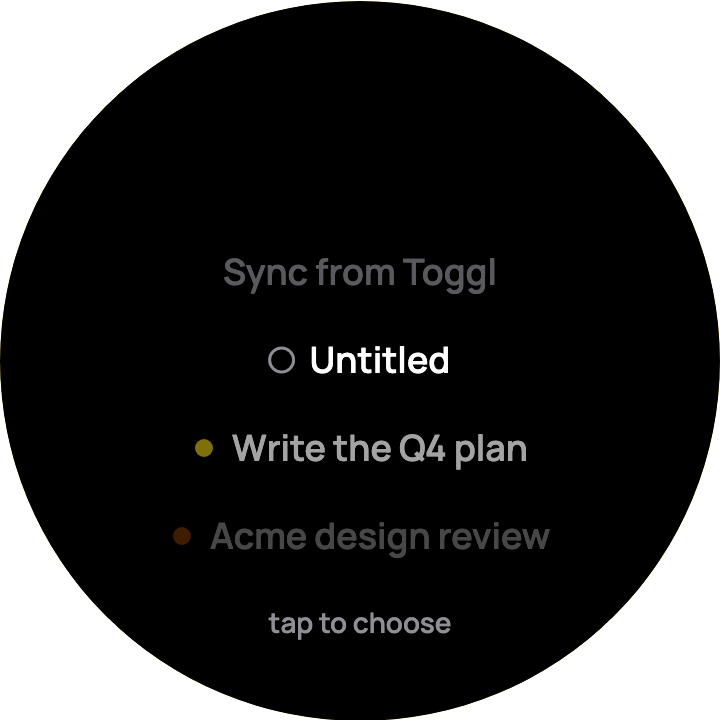

- Below "Untitled" are your last 20 entries, newest first. The same name with the same project appears only once. Each row has a dot in its project's color, or a hollow ring for no project. Long names end in "…".
- A task that you start or rename on the knob moves to the top of the list right away, without a sync. Entries that you make on another device appear after "Sync from Toggl".
- Choosing a task sets the task *and* that entry's project.
  - **While tracking:** the current entry stops and a new one starts with the chosen task. The counter keeps going.
  - **In a running Pomodoro:** the running entry is renamed.
  - Choosing the task you already have changes nothing, so no new entry starts.
- **"Untitled"** clears the task and keeps the project.

### Projects

**Tap the pill** to choose a project.

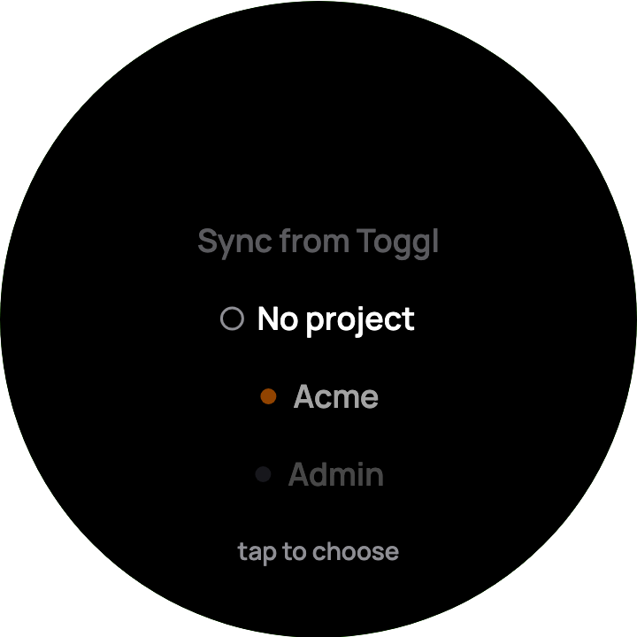

- Below "No project" are your Toggl projects, sorted by name.
- Choosing one updates the running entry too. Changing the project drops any link to a Toggl task, since a task belongs to its project.
- If you've never picked a project, the knob selects your project named **Work** (if you have one) once it has loaded your projects.
- Your project stays even if it isn't in the list (an archived project, say), until you turn and choose another. If the knob has no projects yet, the list says "no projects yet".

### No project, no task, long tasks

| No project, untitled | A long task scrolls |
|:-:|:-:|
| 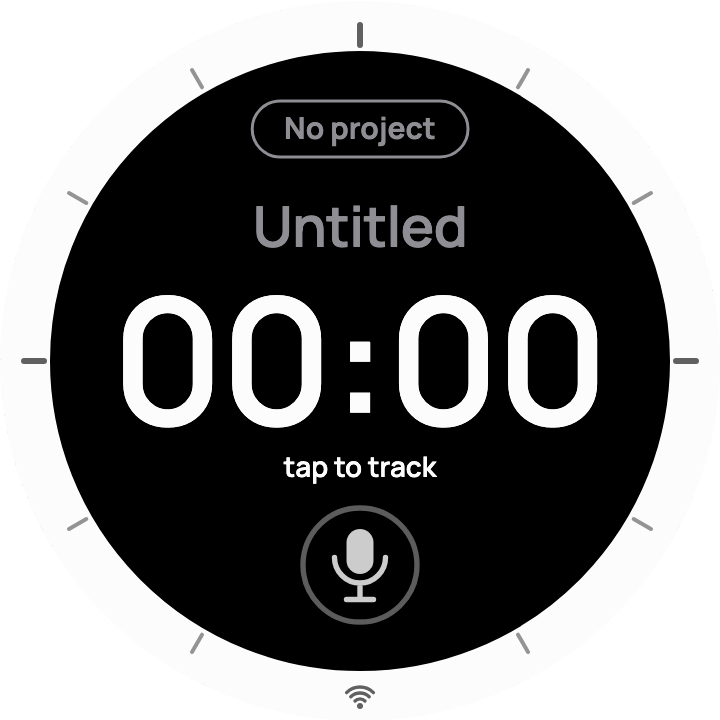 | 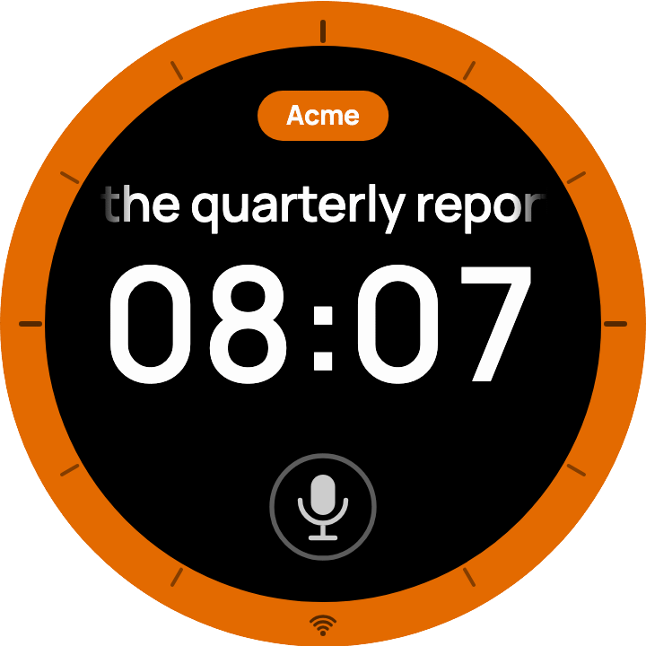 |

The screen shows plain letters. Accented letters lose their accents, curly quotes become straight, and emoji are left out. Toggl keeps the original text.

## Voice

Tap the **mic** and say what you're working on, such as "Acme design review".

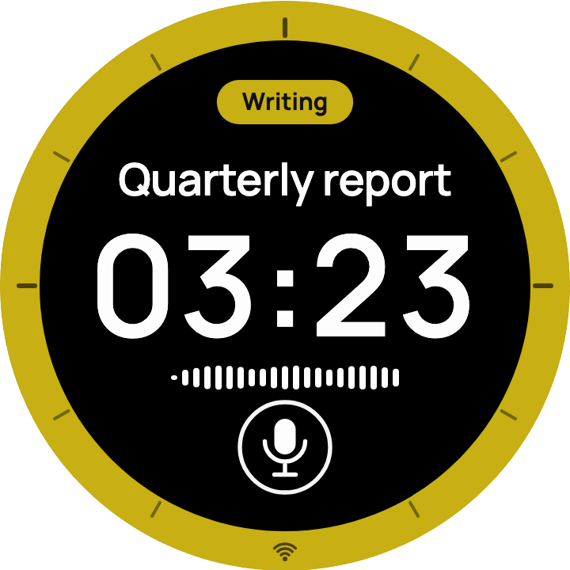

- While it listens, a waveform shows the knob hearing you.
- It stops by itself about 1.3 seconds after you finish talking. You can also tap anywhere to stop it. It gives up after 6 seconds if you say nothing, and never records more than 15 seconds.
- Then you'll see "transcribing…" for a moment, and the text becomes the task.
- **Saying a project's name picks that project.** For example, "Acme design review" selects Acme. The name has to appear as whole words; if several match, the longest wins.
- **While running**, the new task renames the running Toggl entry. No new entry starts.
- If it didn't work, you'll see "didn't catch that" (nothing that sounded like speech, or under half a second), "no Wi-Fi", or "transcription failed".

Audio leaves the knob only when you tap the mic, and only to OpenAI for transcription. Your Toggl project names go along as spelling hints.

## How it works with Toggl

- **Entries start right away.** The moment you start, Toggl gets a running entry with your task and project. Pausing stops it, and resuming starts a new entry with the same task and project. A reset or time's up stops it too.
- **Accidental taps leave nothing behind.** A stretch stopped within 10 seconds is deleted from Toggl. The knob's counter still includes those seconds.
- **Turning the knob moves the start.** While tracking, clicks move the running entry's start in Toggl too. They're sent as a single update a couple of seconds after the last click.
- **Changes follow the running entry.** A new task by voice, or a new project from the list, updates the running entry. Changes made within a moment of each other go out together. Only what changed is sent, so turning the knob never rewrites an entry's description. Picking a past task while tracking starts a new entry instead.
- **If Toggl says no.** If Toggl turns something down for good (for example, the entry's project was archived), you'll see "not saved in Toggl". The knob keeps counting; swipe down to see what Toggl has.
- **Swipe down to sync (Tracking only).** The knob asks Toggl once what's running ("syncing…"):
  - **"synced from Toggl":** a timer you started elsewhere (on your phone, say) is now on the knob, with its task, project and start time. The counter continues from that start.
  - **"stopped in Toggl":** the knob's own timer was stopped elsewhere, or Toggl has no entry for it, so the knob pauses. Its total counts up to the moment you swiped.
  - **"in sync":** nothing to change.
  - **"couldn't reach Toggl":** the check failed. Try again in a moment.
- **No background traffic.** The knob only talks to Toggl when you do something: start, pause, reset, change the task or project, choose "Sync from Toggl", or swipe down. Toggl's free plan allows only about 30 requests an hour. A start costs about 1 request, a pause 2, a "Sync from Toggl" 1 and a swipe down 1. Opening a list costs nothing. If Toggl says "too many requests", the knob waits and retries on its own, at most 10 minutes apart. Until then, swipe down and "Sync from Toggl" say "couldn't reach Toggl" without asking again.

### Offline

If Wi-Fi drops, keep using the knob as usual. It remembers each stretch's start and stop times and sends them once it's back online, so Toggl ends up with the right times. A stretch under 10 seconds is dropped. The offline queue holds up to 12 stretches and lives in memory, so it's lost if the knob restarts before Wi-Fi returns.

### Restarts and power loss

Syncing with Toggl is up to you: the knob never checks Toggl on its own. It doesn't remember a *running* timer, so if it restarts or loses power while running, it comes back at 00:00, but the Toggl entry **keeps running**.

- **Pause before you unplug**, or
- **swipe down before you start again:** the knob picks the running entry up with its original start.
- If you tap start instead, Toggl's old entry ends at that moment, so it includes all the time the knob was off.

## Color profiles

Two profiles: **Mono** (white on black, the default) and **Inverted** (black on white). **Swipe left or right** to switch at any time, even while running. Lists are the exception: a swipe there does nothing. You'll see "mono" or "inverted".

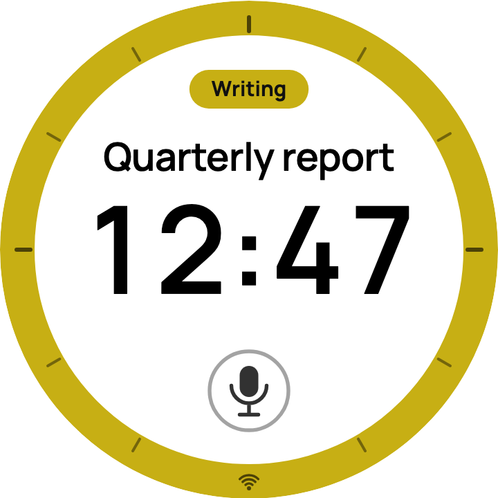

The pill and the Tracking rim keep the project's color in both profiles, and the lists follow the profile. The Pomodoro rim always looks the same: a black band with gray ticks.

## Wi-Fi

The glyph at 6 o'clock shows the connection. It's steady when connected and fades in and out while the knob reconnects.

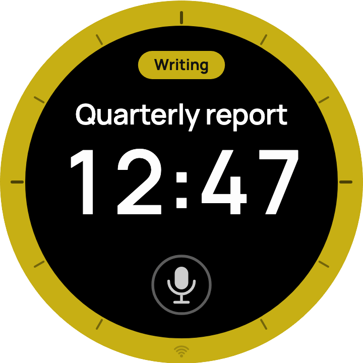

You can keep tracking without Wi-Fi (see [Offline](#offline)). Voice, "Sync from Toggl" and swipe-down sync need a connection. Both lists work offline from the copy on the knob.

## Status messages

| Message | When you see it |
|---|---|
| tap to track | Tracking, reset: tap to start counting up. |
| tap to start | Pomodoro, reset: tap to start the countdown. |
| paused | The timer is paused (breathes slowly). |
| time's up | The Pomodoro reached 00:00. Tap to go back to the set length. |
| reset | After a hold: back to 00:00, or to the set length, with no task and no project. |
| 1 min minimum | Pomodoro: the knob tried to go below 1 minute. |
| 60 min maximum | Pomodoro: the knob tried to go above 60 minutes. |
| pause to adjust | You turned the knob during a running Pomodoro; it's locked until you pause. |
| pause to switch | You swiped up while the timer runs; pause first to change modes. |
| tracking | You switched to Tracking. |
| pomodoro | You switched to Pomodoro. |
| mono | You switched to the Mono profile. |
| inverted | You switched to the Inverted profile. |
| syncing… | After a swipe down, while the knob asks Toggl what's running. In a list, while "Sync from Toggl" reloads it. |
| synced from Toggl | A timer started elsewhere is now running on the knob. |
| stopped in Toggl | The knob's timer was stopped elsewhere (or Toggl has no entry for it); the knob paused. |
| in sync | The swipe-down check found nothing to change. |
| transcribing… | After you spoke, while the speech is turned into text. |
| didn't catch that | Nothing that sounded like speech, a recording under half a second, or an empty transcript. Nothing changed. |
| no Wi-Fi | You tapped the mic while offline, or the connection dropped while sending the audio. |
| transcription failed | The speech service returned an error (for example a bad key or no credit), or the mic couldn't start. |
| tap to choose | At the bottom of a list: turn to choose a row, then tap. |
| tap to sync | At the bottom of a list, when "Sync from Toggl" is highlighted. |
| no recent entries | The knob has no past tasks: you have no entries from the last 30 days, or the first load hasn't happened yet. |
| no projects yet | The knob has no projects yet: on the first start, Toggl hasn't connected yet (it takes about 5 s after power-on) or can't be reached. Choose "Sync from Toggl" to try again. |
| Toggl isn't set up | You tapped the task or pill, or swiped down, but no Toggl key (or no Wi-Fi network) is set. |
| couldn't reach Toggl | "Sync from Toggl" failed (at the bottom of the list, until the next turn), or a swipe-down check failed (on the status line). |
| not saved in Toggl | Toggl turned down a start, a change or a stop for good, for example because the project was archived. The knob keeps counting; swipe down to see what Toggl has. |

## Troubleshooting

| Symptom | What to do |
|---|---|
| The Wi-Fi glyph keeps pulsing | The knob can't join the network. It needs 2.4 GHz Wi-Fi; check the name and password ([README](../README.md#troubleshooting)). |
| There's no mic on the screen | Voice isn't set up: add an OpenAI key ([README](../README.md#2-fill-in-your-credentials-hydrate-the-secrets)). The mic is also hidden while a list is open. |
| "Toggl isn't set up" | Add your Toggl key ([README](../README.md#2-fill-in-your-credentials-hydrate-the-secrets)). |
| "couldn't reach Toggl" or "no projects yet" | Check the Wi-Fi glyph. Right after power-on, wait about 5 seconds. If it lasts, you may have hit Toggl's hourly limit (wait a while), or the organization id is missing ([README](../README.md#troubleshooting)). |
| An entry is missing in Toggl | It ran under 10 seconds (deleted on purpose), it was queued offline and the knob restarted before Wi-Fi returned, or Toggl turned it down ("not saved in Toggl"). |
| A Toggl entry kept running after unplugging | Swipe down to pick it up again, then pause. See [Restarts](#restarts-and-power-loss). |
| A new project or past entry isn't in the list | The lists are a copy on the knob. Turn up to "Sync from Toggl" and tap. |
| The task changed when you only meant to close a list | A tap chooses the highlighted row only after you turn the knob. Without a turn, a tap closes the list. Swipe up or down to close without choosing. |
| "didn't catch that" | Speak within about an arm's length and pause when you're done. Talking nearby keeps it listening for up to 15 s. |
| The time is orange before a Pomodoro starts | That's the warm-up color: the length is under 10 minutes. |
| The vibration stopped before 30 seconds | Any touch or knob turn stops it. |
| The task shows without accents or emoji | The screen only draws plain letters; Toggl keeps the full text. |
